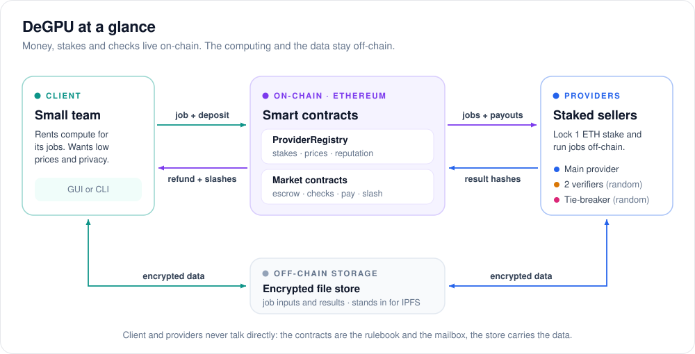

# DeGPU

DeGPU is a small decentralized compute marketplace, built as a university blockchain course project. Small teams rent idle computers from providers who lock a stake. Payment, stakes and verification live on-chain; the compute runs off-chain.



*The client (left) and the providers (right: main, verifiers, tie-breaker) meet only through the smart contracts, which handle money and decisions (1, 2), and the encrypted storage, which carries the data (3, 4).*

- **New here?** [docs/INTRODUCTION.md](docs/INTRODUCTION.md) is a short tour with pictures.
- **Want to run it with classmates?** Follow the [usage guide](#usage-guide-run-a-degpu-network).

Each **job type** says what a provider computes. Each **verification mode** is a different market contract that says how the platform knows the answer is right:

| Mode | How work is checked | Built-in job type |
|---|---|---|
| **replicated**, exact | Random providers re-run the work and the contract compares result hashes; a tie-breaker settles mismatches | `image-classify-v1`: top-1 ImageNet label with a client-supplied ONNX model (MobileNetV2 in the demo) |
| **replicated**, similar | Random providers re-run the work. The client compares the result files with the task's pinned metric and disputes the ones that differ; a tie-breaker re-runs those and judges | `blender-render-v1`: render frames of a `.blend` scene with Blender Cycles (needs Blender 5.2) |
| **checked** | A checker contract verifies every answer on-chain | `key-search-v1`: find the key hidden in a range, given its hash |

**Contents:** [Usage guide](#usage-guide-run-a-degpu-network) · [How verification works](#how-verification-works) · [Architecture](#architecture) · [Job flows](#job-flows) · [Outcomes](#outcomes) · [For developers](#for-developers) · [Repository layout](#repository-layout) · [Known limitations](#known-limitations)

---

## Usage guide: run a DeGPU network

DeGPU runs on several laptops on the same Wi-Fi:
- **One laptop is the host.** It runs the shared chain, the encrypted file store and a faucet that hands out test ETH.
- **Everyone joins with their own wallet and their own app.** The app runs on your laptop, signs your transactions and does the automatic steps of your jobs. You use it from a browser (the GUI) or from the command line; both do the same things.
- **Each user can buy compute (client), sell it (provider), or both.**

All money is test ETH from the faucet, which has no value. We don't use real ETH: the contracts aren't audited, and every step would cost real fees.

### What each laptop needs

| Laptop | Software |
|---|---|
| Every laptop | This repository and [`uv`](https://docs.astral.sh/uv/) |
| The host | Also [Foundry](https://getfoundry.sh/), for the local chain (`anvil`) |
| Providers who want render jobs | Also Blender 5.2 |
| Clients who post image jobs with the demo photos | Also the demo assets (one command in step 1) |

### Step 1: install (every laptop)

```bash
git clone https://github.com/mohan-zeyu/DeGPU.git && cd DeGPU
brew install uv                         # or: curl -LsSf https://astral.sh/uv/install.sh | sh
uv sync                                 # Python 3.12 and every library DeGPU uses
```

Extras, only where needed:

```bash
brew install foundry                    # the host: anvil, forge, cast (or: curl -L https://foundry.paradigm.xyz | bash && foundryup)
brew install --cask blender             # providers who want render jobs
uv run scripts/fetch_demo_assets.py     # clients: the MobileNetV2 model (~14 MB) and 200 demo photos, for image jobs
```

### Step 2: start the network (the host)

On the host laptop:

```bash
uv run degpu host --fresh
```

It prints:

```
DeGPU network is running.
  join URL   http://192.168.1.20:8600   (give this to the other users)
  chain id   31337, registry 0x…
  faucet     2 ETH per new wallet
  data       /Users/you/.degpu/host
Ctrl-C to stop.
```

- **Share the join URL** with everyone, for example in the class chat.
- **Keep this terminal open.** Ctrl-C stops the network.
- **`--fresh` starts a new chain:** new contracts, no jobs, no balances. Without it, the host continues the chain it saved last time.
- **macOS asks** whether Python may accept incoming connections. Click Allow, or nobody can join.
- **The host's owner can take part too.** Open a second terminal and follow step 3 like everyone else.

### Step 3: join (everyone)

Start your app with the join URL:

```bash
uv run degpu app --network http://192.168.1.20:8600 --locked
```

Then open **<http://127.0.0.1:8700>** in your browser:
1. On the start screen, choose **New wallet** and give it a name and a password. (**Import wallet** takes an existing private key. Use a test key, never one that holds real money.)
2. On the home screen, click **Get test ETH**. The faucet gives each wallet 2 test ETH, once.

The same with commands:

```bash
uv run degpu wallet new alice           # asks for a password
uv run degpu app --network http://192.168.1.20:8600 --wallet alice    # asks the password, then keeps running
```

Then, in a second terminal:

```bash
uv run degpu faucet                     # 2 test ETH, once per wallet
uv run degpu status                     # network, wallet, balance
```

- **Keep the app running** while you take part. It does the automatic steps of your jobs: accepting, computing, committing, revealing and sharing keys.
- **The app remembers** the network and the wallet, so next time `uv run degpu app` is enough.
- **Your wallet** is an encrypted file in `~/.degpu/`. Without its password nobody can use it, including you.

### Step 4: sell compute (providers)

In the GUI, open **Provide compute**: choose a stake and your prices, click **Register**, then switch **serving** on.

With commands:

```bash
uv run degpu provider register --stake 1   # offers every job type this laptop can run, at its default price
uv run degpu provider serve on             # your app now accepts and runs jobs by itself
uv run degpu provider show                 # stake, prices and record
```

- **Stake:** at least 0.8 ETH; 1 ETH by default.
- **Prices:** the defaults are 0.0001 ETH per image or key and 0.001 ETH per frame. Set your own with `--price key-search-v1=0.0002` when registering (once per job type), or later with `uv run degpu provider price key-search-v1 0.0002`.
- **Render jobs** are offered only when Blender is installed.
- **While serving,** you can be picked as the main provider of a job, or drawn at random as a verifier or tie-breaker. Every role is paid. A wrong result costs 30% of your stake, and a missed deadline 10% (5% as a verifier or tie-breaker).

### Step 5: buy compute (clients)

In the GUI:
- **Market** shows the providers, their prices and their records.
- **Post a job** asks for the job type, its inputs and a main provider. For image and render jobs it also asks whether to verify.
- The job's page shows each step as it happens, and the results at the end.

With commands:

```bash
uv run degpu market providers           # who sells what, at what price
uv run degpu client post key-search-v1 --main 0x99Fa --keys 10 --wait
uv run degpu client post image-classify-v1 --main 0x99Fa --limit 20 --verify --wait
uv run degpu client post blender-render-v1 --main 0x99Fa --frames 1-12 --verify --wait --out frames/
uv run degpu client jobs                # your jobs, as client or provider
uv run degpu client status replicated:1 # one job's state and timeline
uv run degpu client results replicated:1
uv run degpu log -f                     # what your app does, automatic steps included
```

- **`--main`** is the provider you pick. The first characters of its address are enough.
- **Inputs:** each job type has its own. `uv run degpu client post TASK --help` lists them:

  | Job type | Inputs | Defaults |
  |---|---|---|
  | `key-search-v1` | `--keys N`, `--bits B`, `--impossible N` | 10 keys, each hidden among 2^16 values |
  | `image-classify-v1` | `--model FILE.onnx`, `--images DIR`, `--limit N` | the demo model and photos in `assets/`, the first 200 |
  | `blender-render-v1` | `--scene FILE.blend`, `--frames 1-12` | `assets/demo_scene.blend`, which `scripts/make_demo_scene.py` builds with Blender |

- **`--verify`** (image and render jobs) secretly asks for full checking. The deposit is 2 × the price either way; if the job isn't verified, half of it comes back.
- **A verified job needs 3 providers online besides you:** the main and 2 verifiers, plus a 4th for a tie-break. With fewer, the job runs unverified.
- **Keep your app running until the job closes.** It reveals your secret decision, shares keys with the verifiers and reviews rendered frames.
- **If a provider disappears,** wait for the step's deadline (5–10 minutes), then run `uv run degpu client expire replicated:1` (or click **Move on** in the GUI). The provider is slashed and you get your money back.

### Step 6: stop, leave or start over

- **Stop selling:** run `uv run degpu provider serve off`, then set your prices to 0 (`uv run degpu provider price key-search-v1 0`, and the same for every job type you offer). Until your prices are 0 you can still be drawn as a verifier, and a provider who doesn't answer is slashed. The GUI's serve switch offers to do both.
- **Take your stake back** when you are in no open job: `uv run degpu provider withdraw 1`.
- **Close the app** with Ctrl-C once your jobs are closed.
- **The host** stops the network with Ctrl-C:
  - `uv run degpu host` continues the same chain later;
  - `uv run degpu host --fresh` starts a new one. Everyone then restarts their app, gets test ETH again and registers again. Wallets stay the same.

### Example: a class demo on 5 laptops

| Laptop | Role | What to run |
|---|---|---|
| 1 | Host and client | `degpu host --fresh`, then join as a client |
| 2–5 | Providers | join, `provider register`, `provider serve on` |

Then post four jobs from laptop 1:
1. **Key search:** `client post key-search-v1 --main <laptop 2> --keys 10 --impossible 1 --wait`. The provider is paid for the 10 keys it found, and the impossible puzzle is refunded.
2. **Verified image job:** `client post image-classify-v1 --main <laptop 2> --limit 20 --verify --wait`. Two random providers each re-run half of the photos, and everyone is paid.
3. **Catch a cheater:**
   - On laptop 3, run `provider serve on --behavior cheat`: it fakes some of its labels.
   - Post a verified image job with laptop 3 as the main provider.
   - The verifiers catch the fakes, a tie-breaker confirms, and laptop 3 loses 0.3 ETH of stake. The **Market** page shows it in laptop 3's record.
4. **A provider goes offline:**
   - On laptop 4, run `provider serve on --behavior offline`.
   - Post a job to laptop 4, wait for the deadline, then run `client expire`. Laptop 4 loses 10% of its stake.

`--behavior` (`cheat`, `liar` or `offline`) exists only for presentations. In the GUI it hides behind the **Presentation mode** switch. Afterwards, switch the laptops back with `provider serve on --behavior honest`.

### Rehearse alone on one laptop

Everything also runs on one laptop, with one app per user. Give each app its own folder (`DEGPU_HOME`) and its own port:

```bash
uv run degpu host --bind 127.0.0.1 --fresh                                                       # terminal 1
DEGPU_HOME=~/.degpu-bob   uv run degpu app --network http://127.0.0.1:8600 --locked --port 8701  # terminal 2: a provider
DEGPU_HOME=~/.degpu-alice uv run degpu app --network http://127.0.0.1:8600 --locked --port 8702  # terminal 3: a client
```

- **GUI:** open <http://127.0.0.1:8701> and <http://127.0.0.1:8702> in two browser tabs.
- **CLI:** point it at one app with `--app`, before the command: `uv run degpu --app http://127.0.0.1:8702 client jobs`.
- A verified job needs two more provider apps (ports 8703 and 8704, say).

### Troubleshooting

| Problem | What to do |
|---|---|
| `the DeGPU app is not running` | Start `uv run degpu app` and keep it open. If it runs on another port, add `--app http://127.0.0.1:PORT` before the command. |
| Nobody can reach the host | Check that everyone is on the same Wi-Fi, that the host allowed Python in the macOS firewall, and that the URL is the printed join URL. Some campus networks block traffic between laptops: use a phone hotspot instead. |
| `already got its test ETH` | The faucet pays each wallet once. |
| A job ran unverified | Fewer than 3 other providers were online and offering that job type. |
| Render jobs aren't offered | Install Blender 5.2 and restart the app. If you registered before that, set a price: `uv run degpu provider price blender-render-v1 0.001`. |
| A job is stuck | After its deadline, `uv run degpu client expire MODE:ID` settles it. Whoever didn't act in time is slashed. |
| Providers refuse your jobs | Everyone must run the same version of this repository. The GUI warns when your job type's code differs from the network's. |

Every command has help: `uv run degpu --help` and `uv run degpu COMMAND --help`. The CLI and the GUI only call the app's HTTP API, described in [docs/API.md](docs/API.md); [docs/FRONTEND.md](docs/FRONTEND.md) describes the GUI.

---

## How verification works

**Replicated jobs** keep the client's decision about verification secret:
- **Same deposit either way.** Every job locks 2 × price. The chain shows only a hash of the decision, so the main provider can't tell which jobs will be checked and has to run every job honestly.
- **Revealed after the provider commits.** The client reveals the decision only after the main provider has committed to its results.
  - **"No":** the main provider is paid and the client gets the unused half of the deposit back.
  - **"Yes":** the contract draws **2 random verifiers**. Each re-runs half of the items, so every item is checked. On any mismatch, a random **tie-breaker** re-runs only the mismatched items, the majority decides each item, and the outvoted provider is slashed.

  Faking earns at most the job price (0.020 ETH in the demo) but risks a 0.3 ETH slash, so cheating stops paying once about 1 in 15 jobs is verified.
- **Rendered frames are never bit-identical** across machines, so render jobs are compared by **similarity**:
  - the client's software compares the main provider's frames with the verifiers', tile by tile, using an integer rule pinned with the task;
  - it disputes the frames that differ, posting a bond;
  - a random tie-breaker re-renders those frames and decides who was wrong.

  If the dispute was unfounded, the bond pays the tie-breaker.

**Checked jobs** are simpler:
- A wrong answer is rejected by the checker contract, so it can never be paid.
- The main provider is paid per solved puzzle, and the client gets the rest back.
- A provider that misses its deadline is slashed.

Further reading:
- A short introduction with pictures: [`docs/INTRODUCTION.md`](docs/INTRODUCTION.md).
- How the code fits together: [`docs/ARCHITECTURE.md`](docs/ARCHITECTURE.md).
- **Adding a job type:** [`docs/ADDING_A_JOB_TYPE.md`](docs/ADDING_A_JOB_TYPE.md). It is one folder under `degpu/tasks/`, plus a small checker contract for checked jobs.
- Interface spec (names, encodings, rules): [`docs/INTERFACE.md`](docs/INTERFACE.md).
- **The app's HTTP API** (for the CLI and the GUI): [`docs/API.md`](docs/API.md). Building the GUI on it (screens, calls, types): [`docs/FRONTEND.md`](docs/FRONTEND.md).

## Architecture

```
            ┌──────────────────────────── Ethereum (anvil) ─────────────────────────────┐
            │  ProviderRegistry            MarketBase                                   │
            │  stake, X25519 key,  ◀────▶  ├─ ReplicatedMarket  hidden decision, draws, │
            │  price per (market, task),   │                     compare, tie-break     │
            │  stats per market            └─ CheckedMarket ──▶ IChecker (KeySearch)    │
            └──────────────▲───────────────────────────────────────▲────────────────────┘
                           │                                       │
                    ┌──────┴──────┐                       ┌────────┴──────────┐
                    │   Client    │                       │ Provider agents   │
                    └──────┬──────┘                       └────────┬──────────┘
                           └─── degpu/modes/  (one driver per mode) ───┘
                           └─── degpu/tasks/  (one folder per job type) ───┘
                           └─── degpu/storage.py  (encrypted blobs; stands in for IPFS)
```

| Part | Files | What it does |
|---|---|---|
| Contracts | `contracts/src/` | The registry holds each provider's stake, X25519 key, price per (market, task type) and reputation; only the markets the owner added may lock, slash or bump. `MarketBase` holds what every market shares: task table, price pinning and payouts. `ReplicatedMarket` and `CheckedMarket` each implement one verification mode. |
| Tasks | `degpu/tasks/` | `base.py` is the interface a job type implements; `__init__.py` finds every installed task. `image_classify_v1/` holds the ONNX runner (its folder hash is pinned on-chain). `key_search_v1/` holds the key-search solver. |
| Mode drivers | `degpu/modes/` | The off-chain half of each market: what the client and each provider role do in each phase. |
| Client / agent | `degpu/client.py`, `degpu/agent.py` | Thin shells around one account: keys, store, saved state, offered tasks. Each job goes to its mode's driver. Agent behaviours: `honest`, `cheat`, `liar`, `offline`. |
| Chain glue | `degpu/chain.py` | Starts anvil, loads the ABIs from `contracts/out/`, deploys the registry, both markets and every installed task, sends txs, decodes events, and time-travels. |
| Crypto, storage | `degpu/crypto.py`, `degpu/storage.py` | keccak and `abi.encode` commitments, HKDF keys, NaCl encryption, and the local content-addressed store. |

**Privacy (replicated mode):**
- Every file is encrypted with a key derived from a random per-job key `k_job`.
- The main provider gets `k_job` and sees every item.
- Each verifier gets only its half of the items, and the tie-breaker only the mismatched ones.
- The chain stores only hashes, salted result leaves and sealed blobs.

Checked-mode puzzles are public.

## Job flows

**Replicated:**

```
client  createJob(M, task, N, dataHash, verifyCommit, sealed k_job) + 2·N·price      → Open
M       checks runner hash + inputs against dataHash, accept()                        → Committing
M       commitResults(keccak(all N leaves))   (doesn't know yet if it will be checked) → Deciding
client  revealDecision(verifySalt, verify)    (checked against verifyCommit)
          "no"  → Publishing
          "yes" → draw 2 verifiers (among providers offering the task)              → Checking
client  shareRange(slot, item keys sealed to that verifier)   (for each verifier)
V0, V1  commitCheck(keccak(vSalt, range leaves))                                      → CheckReveal
V0, V1  revealCheck(range leaves, vSalt)                                              → Publishing
M       publishResults(all N leaves)  (checked vs resultsCommit) → compare every checked item
          all match → Verified         mismatches on X → draw T → TieBreak
client  shareTiebreak(keys of X sealed to T)
T       submitTiebreak(leaves for X) → per item, majority of {M, owning verifier, T} → slash the outvoted, settle
```

**Replicated, similar (render jobs):** the same up to `publishResults`; only the comparison changes.

```
M, V0, V1  also upload their output files, encrypted; each leaf pins keccak(file)
M       publishResults(all N leaves, resultsURI)                                       → Disputing
client  compares M's files with each verifier's (task.similar):
          all similar → acceptResults → Verified (or Delivered if unverified)
          some differ or missing → dispute(items) + bond → draw T                      → TieBreak
client  shareTiebreak(keys for those items and both sides' files, sealed to T)
T       re-renders them, compares with both sides' files → submitJudgement(verdicts)
          per item: T agrees only with M → verifier outvoted; only with V → M outvoted;
          with both → dispute rejected (the bond pays T); with neither → unresolved
```

**Checked:**

```
client  createJob(M, task, items) + N·price        (items are public)                → Open
M       accept()                                                                       → Working
M       submitResults(items, answers, found)  → the checker verifies every found answer;
          any wrong answer reverts the call   → M paid per solved item, client gets the rest
M misses the deadline → anyone calls expire() → M slashed 10%, client fully refunded
```

**Why cheating does not pay:**
- **Replicated mode:**
  - M commits before it knows whether the job is verified.
  - On a verified job every item is re-run, so any faked item is caught.
  - Nobody can copy, because M and both verifiers commit before anyone reveals.
  - `dataHash` and `verifyCommit` pin the client's inputs and decision.
- **Checked mode:** the contract checks every answer itself.

## Outcomes

Demo settings:
- stake 1 ETH (suspended below 0.8 ETH);
- 0.0001 ETH per image or per puzzle;
- tie-breaker fee 0.002 ETH;
- slashes: wrong result 30%, a main provider misses a deadline 10%, a verifier or tie-breaker misses one 5%.

**Settlement rule:** each party is paid or slashed on its own result, and the client gets everything left over: unused deposit plus all slashed stake.

**Replicated** (200 images, so price 0.020 and deposit 0.040):

| Outcome | Client (net) | Main M | Verifiers | Tie-breaker T |
|---|---|---|---|---|
| Cancelled (not accepted) | 0 | — | — | — |
| Delivered (unverified) | −0.020 | +0.020 | — | — |
| Verified | −0.040 | +0.020 | +0.010 each | — |
| MainOutvoted | +0.278 (gets M's 0.3 slash) | −0.3 stake | +0.010 each | +0.002 |
| VerifierOutvoted (both lied) | +0.578 | +0.020 | −0.3 stake each | +0.002 |
| BothOutvoted | refund + slashes − honest pay | −0.3 | the right one +0.010, the wrong one −0.3 | +0.002 |
| NoMajority | refund − pay for the parts that matched | unpaid | the clean half paid | +0.002 |
| MainMissed (`expire`) | +0.100 | −0.1 stake | paid if they finished | — |
| A verifier misses | that half's fee back + its 0.05 slash | +0.020 | −0.05 stake | — |
| TiebreakerMissed | refund + T's slash | unpaid | the clean half paid | −0.05 stake |
| Client never shares (a range or the tie items) | forfeits that pay | +0.020 | paid anyway | — |

**Replicated, similar** (12 frames at 0.001, so price 0.012 and deposit 0.024). The same settlement as above, plus disputes:

| Outcome | Client (net) | Main M | Verifiers | Tie-breaker T |
|---|---|---|---|---|
| Verified (accepted, no dispute) | −0.024 | +0.012 | +0.006 each | — |
| MainOutvoted (M's frames bad) | +0.286 (M's slash; the bond comes back) | −0.3 stake | +0.006 each | +0.002 |
| VerifierOutvoted (a verifier's frames bad) | +0.280 | +0.012 | the bad one −0.3, the other +0.006 | +0.002 |
| DisputeRejected (nothing was wrong) | −0.026 (the bond pays T) | +0.012 | +0.006 each | +0.002 |
| Unverified, M's frames missing or bad | +0.298 (M's slash minus T's fee) | −0.3 stake | — | +0.002 |

**Checked** (20 puzzles, so deposit 0.002):

| Outcome | Client (net) | Main M |
|---|---|---|
| Cancelled (not accepted) | 0 | — |
| Delivered, k puzzles solved | −k × 0.0001 | +k × 0.0001 (unsolved puzzles are refunded, never slashed) |
| Wrong answer submitted | — | the call reverts; nothing is paid |
| MainMissed (`expire`) | +0.100 | −0.1 stake |

Reputation counters live in the registry, per market:
- replicated: verified and unverified completions, misses and outvoted for main providers; checks completed, missed and outvoted for verifiers and tie-breakers;
- checked: jobs completed, misses, items solved, items not found.

The exact rules are in `docs/INTERFACE.md`, sections 7 and 8.

## For developers

The usage guide above is the product path. This section is for working on the code: the tests, the one-process demo and the older per-process commands.

### Setup

```bash
brew install foundry                    # forge, anvil, cast (or: curl -L https://foundry.paradigm.xyz | bash && foundryup)
uv sync                                 # Python 3.12 venv with web3, pynacl, onnxruntime, pillow, numpy, pycryptodome, fastapi, pytest
uv run scripts/fetch_demo_assets.py     # MobileNetV2 ONNX (~14 MB) + 200 Imagenette photos into assets/
brew install --cask blender             # optional: Blender 5.2 for the render jobs (without it they are skipped)
uv run scripts/calibrate_render.py      # with Blender: measure honest vs cheating renders, check the threshold
```

### Tests and the demo

```bash
cd contracts && forge test              # Solidity tests: both markets, settlement, reverts, draws, task types, gas, deploy
uv run pytest                           # Python tests: libraries, conformance tests for every task, e2e on a real anvil chain
uv run scripts/demo.py                  # the nine demo scenarios on a fresh anvil (8 and 9 need Blender)
```

The Python helpers run `forge build` on their own when `contracts/out/` is missing. After editing a contract, run `forge build` yourself.

### The demo

`scripts/demo.py` sets everything up in one process:
- starts a fresh anvil;
- deploys the registry, both markets and both tasks;
- registers providers A–F (anvil accounts 2–7), each with 1 ETH stake and offering both tasks;
- posts the jobs from account 1;
- runs a deterministic step loop over the client and the agents.

For each scenario it prints the agents' log, the job's on-chain event timeline and a balance table, then asserts the results net of gas. "Net of gas" means wallet change plus the gas the account paid, cross-checked against the `Payout` / `ProviderSlashed` events and the registry stakes. If any check fails, it exits with code 1.

| # | Scenario | Expected (ETH) |
|---|---|---|
| 1 | Unverified image job (secret "no"), main A | client −0.020; A +0.020 |
| 2 | Verified image job (secret "yes"), main A, all honest. Also shows that jobs 1 and 2 looked identical on-chain | client −0.040; A +0.020; each verifier +0.010 |
| 3 | Main E fakes 20% of labels (verified) | E slashed 0.3; verifiers +0.010 each; T +0.002; client +0.278. All 40 fakes are caught |
| 4 | Every provider except A lies as verifier | both verifiers slashed 0.3; A +0.020; T +0.002; client +0.578 |
| 5 | Main F goes offline, then time travel and `expire()` | F slashed 0.1; client +0.100 |
| 6 | Key search, main A: 19 hidden keys + 1 puzzle whose key is outside its range | A +0.0019; client −0.0019 (the unsolvable puzzle is refunded) |
| 7 | Key search, main E submits made-up keys | the checker rejects them on-chain; `expire()` → E slashed 0.1; client +0.100 |
| 8 | Render job (similarity), main A, 12 frames, verified, all honest | the client accepts without a dispute; client −0.024; A +0.012; each verifier +0.006 |
| 9 | Render job (similarity), main E degrades 3 of 12 frames | the client disputes exactly those, the tie-breaker confirms; E slashed 0.3; verifiers +0.006 each; T +0.002; client +0.286 |

In scenario 5, F may have been one of the slashed liars in scenario 4 (about half the runs), and in scenario 7, E was slashed in scenario 3. A provider whose stake fell first tops it back up to 1 ETH.

### Running the pieces by hand

Use one terminal per command. Every fresh anvil puts the registry at the same address:

```bash
uv run python -m degpu.chain --port 8545                     # anvil + contracts + every task; prints the registry
uv run python -m degpu.agent --index 2 --behavior honest --registry 0x5FbDB2315678afecb367f032d93F642f64180aa3
uv run python -m degpu.agent --index 3 --behavior honest --registry 0x5FbD...
uv run python -m degpu.agent --index 4 --behavior honest --registry 0x5FbD...
uv run python -m degpu.agent --index 5 --behavior liar   --registry 0x5FbD...
uv run python -m degpu.client --registry 0x5FbD... post image-classify-v1 --main A --limit 20 --verify --wait
uv run python -m degpu.client --registry 0x5FbD... post key-search-v1 --main B --keys 10 --impossible 1 --wait
uv run python -m degpu.client --registry 0x5FbD... post blender-render-v1 --main A --frames 1-12 --verify --wait --out frames/
uv run python -m degpu.client --registry 0x5FbD... status replicated:1
uv run python -m degpu.client --registry 0x5FbD... results checked:1
```

Each task adds its own flags to `post <task>`; see `post <task> --help`. Leave out `--verify` to post an image job with a secret "no". A verified image job needs at least 4 active providers that offer the task: the main, 2 verifiers and a tie-breaker.

How the processes find each other:
- Agents and the client use anvil's unlocked accounts (`--index`). Agents offer every installed task unless `--tasks` limits them.
- Each agent keeps its X25519 key and per-job secrets in `.degpu-state/<address>.json`, so it can be restarted.
- The client keeps its job secrets in `.degpu-state/client-<address>.json`, including each image job's secret decision and salt.
- All processes must share the same store directory (`DEGPU_STORE`).

## Repository layout

```
contracts/src/          ProviderRegistry.sol, MarketBase.sol, ReplicatedMarket.sol, CheckedMarket.sol,
                        IChecker.sol, checkers/KeySearchChecker.sol
contracts/test/         Foundry tests (Settlement, Reverts, Draw, Encoding, Gas, Deploy, TaskTypes, CheckedMarket)
contracts/script/       Deploy.s.sol (RUNNER_HASH=0x.. forge script ... --broadcast)
degpu/                  chain.py, agent.py, client.py, crypto.py, storage.py,
                        wallet.py, host.py, node.py, api.py, cli.py (the product path: `degpu ...`)
degpu/modes/            base.py (driver API), replicated.py, checked.py
degpu/tasks/            base.py (task API), image_classify_v1/ (task.py, runner.py), key_search_v1/,
                        blender_render_v1/ (task.py, render.py, similarity.py)
scripts/                fetch_demo_assets.py, demo.py, make_demo_scene.py (runs in Blender), calibrate_render.py
tests/                  test_crypto, test_storage, test_runner, test_decode, test_key_search, test_similarity,
                        test_tasks (conformance, every task), test_e2e; fake_render/ (a test-only similar task);
                        test_wallet, test_host, test_app (host + five users through the API)
docs/                   INTRODUCTION.md (a short tour; its pictures are in docs/img/), ARCHITECTURE.md,
                        ADDING_A_JOB_TYPE.md, INTERFACE.md (v4), API.md (the app's HTTP API),
                        FRONTEND.md (how the GUI uses it)
frontend/               the GUI (React + Vite + TypeScript); `npm run build` writes degpu/web/, which the app serves
degpu/web/              the built GUI (committed, so users need no Node)
```

## Known limitations

- **The main provider sees every image** of a replicated job. Hiding data from the provider would need secure hardware (TEE), which is out of scope.
- **Verified replicated jobs cost 2× the price**, because every item is re-run once. The hidden decision lets clients verify only some of their jobs and still deter cheating on all of them.
- **Client patterns can leak the decision.** A provider might guess from a client's history, e.g. a client that always verifies.
- **A caught main provider can skip publishing.** It sees the revealed checks before it must publish, so it can take the 10% missed-deadline slash instead of the 30% wrong-result slash, and the client gets no labels.
- **Nothing forces the tie-breaker to run the items.** Both sides' leaves are public when it submits, so it could copy one side.
- **Randomness and collusion.** The draws use `prevrandao` and `blockhash`, which is demo-grade and can be manipulated; Chainlink VRF is the upgrade. A main provider colluding with a drawn verifier (or two colluding providers among M, a verifier and T) can swing an item.
- **Floating-point determinism.** Differences across machines or execution providers could flip a borderline top-1 label. Pinned library versions and single-threaded CPU inference make this unlikely, and the `maxMismatch` tolerance parameter exists for it (0 in the demo).
- **Similarity checks (render jobs):**
  - **The threshold trades two errors.** If it is too loose, a cheaper low-sample render passes; if it is too tight, honest GPU and CPU renders get disputed. It is a 30 dB placeholder until `scripts/calibrate_render.py` has measured the gap with Blender installed.
  - **A lazy tie-breaker** could approve both sides without re-rendering.
  - **The tie-breaker fee is flat (0.002 ETH)** however many frames it re-renders.
  - **The scene can carry Python scripts.** Providers run Blender with auto-run disabled, but there is no real sandbox.
- **Checked mode:**
  - Puzzles and their answers are public on-chain (a found key is visible to everyone).
  - "Not found" is unpaid but never slashed, so a lazy provider can waste a client's time; it shows only in its stats.
- **No mode yet for unverifiable services** (bandwidth, services sold on-chain). See the last section of `docs/ADDING_A_JOB_TYPE.md`.
- **Owner trust.** The registry owner decides which markets may slash stakes.
- **Scale.**
  - Every replicated leaf is posted on-chain, and each revealed check leaf is stored (about 24k gas per item: `revealCheck` of 100 leaves ≈ 2.4M gas).
  - That fits up to the 1,000-item limit; the upgrade path is a Merkle root plus per-item proofs.
- **Push payouts.** A recipient contract that rejects ETH would block a job's settlement. All demo participants are plain accounts.
- **Build setting.** The contracts are compiled without via-IR (`foundry.toml`), which keeps `ReplicatedMarket` under the 24 KB contract-size limit.
- **The network host is trusted.** One laptop runs the chain, so its owner could rewrite it or stop it. It can't read or alter files (they are encrypted and hash-checked), but it could withhold them. A public testnet such as Sepolia removes the chain part: only the network settings change, not the code.
- **The faucet pays once per address,** and anyone can make new addresses. Fine for test ETH; a real network has no faucet.
- **Storage** is the host's folder over HTTP, standing in for IPFS.
- **The GUI** runs only in the user's own browser, against their own app on 127.0.0.1. There are no accounts or logins beyond the wallet's password.
