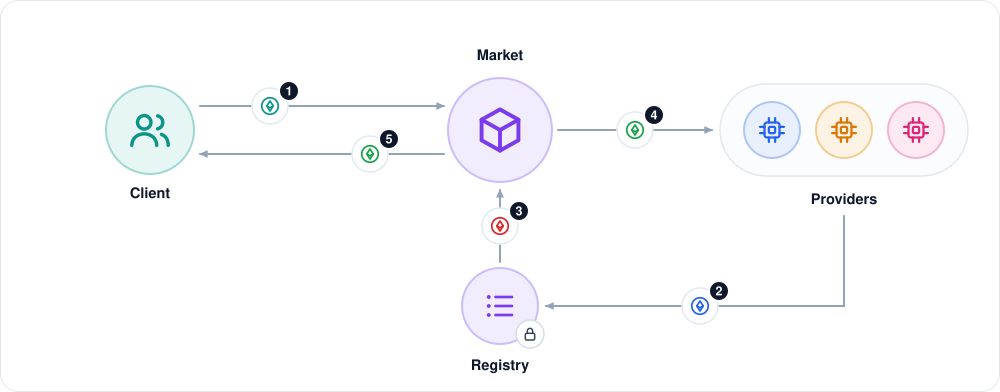
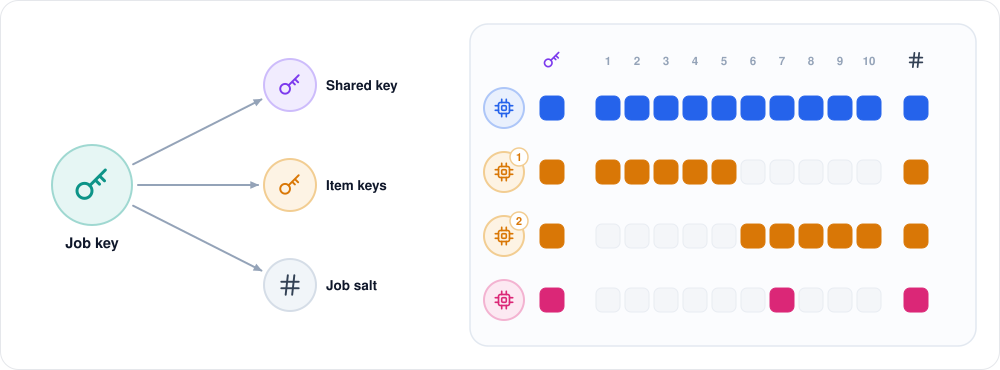

# DeGPU: an introduction

DeGPU is a small decentralized marketplace for computing power, built as a university blockchain course project. This document gives a short tour: what DeGPU does, its main features, how it keeps providers honest, and how the system is built.

For setup and every detail, see the [README](../README.md). For the code, see [ARCHITECTURE.md](ARCHITECTURE.md).

## 1. What is DeGPU?

**The problem.** Small teams often need computing power for a short time: to label a batch of photos, render a few animation frames, or run a search. Big cloud providers are expensive and see all your data. Meanwhile many machines sit idle. Renting from a stranger has a catch, though: how do you know they really did the work, and didn't just send back made-up results?

**Our answer.** DeGPU is a market where:

- **providers** lock a stake (a deposit of ETH) and rent out their idle machines;
- **clients** post jobs and pay into a smart contract;
- **smart contracts** hold the money, pick providers at random to check the work, pay honest providers and **slash** (take part of the stake from) providers who cheat or disappear.

The computing itself runs off-chain, on the providers' machines. Only money, stakes, hashes and decisions go on-chain.

*Figure 1. DeGPU at a glance.* The purple band is on-chain; everything below it is off-chain. Among the providers, blue is the main provider, amber the verifiers and pink the tie-breaker. The numbers mark the four flows:

1. **Client ↔ contracts (coin):** the client posts a job and locks its payment. Refunds, and any stake taken from a cheater, come back the same way.
2. **Contracts ↔ providers (bell):** the contracts tell providers they were picked. Providers send back hashes of their results and are paid or slashed.
3. **Client ↔ storage (lock):** the client uploads its inputs, encrypted, and later downloads the results.
4. **Storage ↔ providers (lock):** providers download only the inputs they may open, and upload their results.

The client and the providers never talk to each other directly.

## 2. Main features

| Feature | What it means |
|---|---|
| **Three job types** | Image classification (an ONNX model labels photos), 3D rendering (Blender renders frames), and key search (find a key that matches a hash). |
| **Two ways to check work** | *Replicated:* random providers re-run the work and compare. *Checked:* a contract tests each answer directly. |
| **Hidden verify decision** | The client secretly decides whether a job will be checked. The provider can't tell, so it must do every job honestly. |
| **Stakes and slashing** | A wrong result costs 30% of the stake, and a missed deadline 10% (5% for a verifier or tie-breaker). Slashed ETH goes to the client. |
| **Private data** | Job files are encrypted. Each provider gets only the keys for the items it must process. |
| **Plug-in job types** | A new job type is one folder of Python code, and it picks one of the existing ways to check work. |
| **Reputation** | The registry counts each provider's finished, missed and outvoted jobs, per market. |
| **Real network mode** | Several laptops on one Wi-Fi: one hosts the chain, and every user has a wallet, an app, a GUI and a CLI. |

The two plug-in layers are the core of the design. A **job type** says *what* to compute. A **verification mode** says *how* the platform knows the answer is right. They are independent, so adding a job type doesn't touch the contracts that check work.

*Figure 2. Two plug-in layers.*

- **Top row, the job types:** image labelling, 3D rendering and key search. The dashed tile is a new job type you add.
- **Bottom row, the verification modes:**
  - *Replicated:* other providers re-run the work. With **=** (exact), the contract checks that the result hashes are equal; image labels work this way. With **≈** (similar), the client checks that rendered frames are close enough.
  - *Checked:* a small checker contract tests each answer on-chain (the ✓ cube), as for key search.
- **The dashed arrows:** a new job type picks whichever mode fits it.

## 3. How a job works

Every job has a few roles:

- **Client:** posts the job and pays.
- **Main provider:** chosen by the client; does the work.
- **Verifiers (2):** drawn at random by the contract; each re-runs half of the work.
- **Tie-breaker:** drawn at random only when the main provider and a verifier disagree.

The figure below follows one replicated job, such as labelling 200 photos, from left to right.

*Figure 3. Life of a replicated job.* The coloured dots under each step show who acts.

1. **Post (lock):** the client locks 2 × the price and a hidden yes/no decision.
2. **Accept (✓):** the main provider checks the inputs and accepts the job.
3. **Commit (#):** the main provider runs the job and sends only a hash of its results.
4. **Reveal (eye):** the client reveals the decision. On "yes", the contract draws 2 random verifiers.
5. **Check (magnifier):** the client sends each verifier the keys for its half of the items, and each verifier re-runs that half.
6. **Publish (upload):** the main provider publishes its results, and the contract compares every checked item.
7. **Tie-break (scales, dashed):** only if some items disagree. A random tie-breaker re-runs just those items.
8. **Settle (coin):** the contract pays, slashes and refunds.

On "no", steps 5 and 7 are skipped (the dashed "no" arc). The key trick is in the amber box, steps 3 and 4:

- When posting, the client locks **2 × the price** and a **hidden yes/no** (only its hash goes on-chain). Every job looks the same on-chain, checked or not.
- The main provider must **commit** to its results (send a hash of them) **before** the client reveals the decision.
- So when the provider works, it doesn't know whether this job will be checked. The only safe choice is to do every job honestly.

If the answer is "no", the main provider is paid and the client gets the unused half of its deposit back. If it is "yes", two verifiers re-run the items, so every item is checked once.

**Checked jobs** are much simpler. The client posts public puzzles (for example "find the key in this range whose hash is X"), and the provider submits its answers. A checker contract tests every answer: a wrong one makes the whole call fail, so it can never be paid. The provider is paid per solved puzzle. If it misses the deadline, anyone can call `expire()` and the provider is slashed.

## 4. Keeping providers honest

### The tie-breaker vote

On a verified job, the contract compares the main provider's results with the verifiers' results, item by item. Most items match. For the items that don't, a third random provider, the **tie-breaker**, re-runs just those items, and the majority of three decides.

*Figure 4. How a mismatch is settled.*

- **Left:** a verified job with 10 items. The blue row holds the main provider's results and the amber row the verifiers'. Verifier 1 re-ran items 1–5 and verifier 2 re-ran items 6–10, so every item is checked once. All items match (=) except item 7 (≠).
- **Right, the vote on item 7:** the main provider answered ▲ and the verifier ●. The tie-breaker re-runs the item and also gets ●, so ● wins 2 to 1.
- **Bottom right:** the outvoted main provider loses 0.3 ETH of stake, which goes to the client. The tie-breaker earns a fee (0.002 ETH in the demo).

For each disputed item, the majority of three decides:

- **The tie-breaker agrees with the verifier:** the main provider is slashed.
- **The tie-breaker agrees with the main provider:** the verifier is slashed.
- **All three differ:** there is no majority. That item isn't paid, and nobody is slashed for it.

The outvoted party is slashed, so lying as a verifier doesn't work either: in the demo, when both verifiers lie, both lose 0.3 ETH and the honest main provider is still paid. Nobody can copy someone else's answer, because everyone commits a hash first and reveals later.

### Render jobs: similar, not equal

Two machines never render exactly the same pixels, so render results can't be compared by hash. Instead:

1. The client's app compares the main provider's frames with the verifiers' frames, tile by tile, using a fixed rule pinned with the job type (every tile must stay within 30 dB PSNR).
2. It disputes only the frames that differ, and pays a small bond to do so.
3. A tie-breaker re-renders those frames and judges who was wrong. If nothing was wrong, the bond pays the tie-breaker, so clients don't dispute for free.

### Why cheating doesn't pay

A provider that fakes a job saves at most the job's price (0.020 ETH for 200 photos in the demo). If it is caught, it loses 0.3 ETH of its stake. So once the client verifies more than about **1 job in 15**, cheating loses money on average, and the client still decides in secret which jobs those are.

*Figure 5. Why cheating doesn't pay.*

- **The blue line** is a cheater's expected gain per faked job: 0.020 − 0.3 × (the share of jobs verified).
- **In the red area** cheating pays.
- **In the green area** it loses money.
- **The line crosses zero** when 1 job in 15 (6.7%) is verified.

| Cheat | What stops it |
|---|---|
| Lazy main provider makes results up | Commit before the hidden decision is revealed; on a verified job every item is re-run; slashed 30% |
| A verifier lies | The tie-breaker vote outvotes it; slashed 30% |
| A provider copies another's answer | Everyone commits a hash first and reveals after |
| A provider goes offline | Deadlines on every step; `expire()` slashes it 10% (5% for a verifier or tie-breaker) |
| Wrong answer to a checked puzzle | The checker contract rejects it on-chain |

## 5. Technical architecture

### Code layers

The code has six layers. Figure 6 shows them from top to bottom, and the table below it says what each icon stands for.

*Figure 6. Code architecture,* from top to bottom:

| Row in the figure | What it is | Code |
|---|---|---|
| **Contracts** (Solidity) | They hold the money, the stakes and every judgement. **Registry** stores stakes, encryption keys, prices and reputation. The two markets, **Replicated** and **Checked**, share `MarketBase`, and they lock and slash stakes in the registry (the coin). **Checker** tests answers for checked jobs. | `ProviderRegistry`, `ReplicatedMarket`, `CheckedMarket`, `KeySearchChecker` |
| **Channels** | The only ways the actors communicate: **State** is the contract's record of each job, **Events** are the mailbox, and **Store** holds the encrypted files. | `getJob`, contract events, `storage.py` |
| **Actors** (Python) | The **client** and the **provider**. Each one wraps one account. | `client.py`, `agent.py`, `node.py` |
| **Modes** | The off-chain half of each market, drawn with the same icons as the markets above. They decide what each role does in each step. | `degpu/modes/` |
| **Job types** | What actually runs: preparing inputs, computing, and reading results. | `degpu/tasks/` |
| **Libraries** | Shared by every layer: hashing and encryption, talking to the chain, and the file store. | `crypto.py`, `chain.py`, `storage.py` |

**The design rule: actors never talk to each other directly.** Everything goes through the three channels:

1. **Contract state** is the single source of truth for where a job is. Every actor reads it to choose its next move.
2. **Contract events** are the mailbox. They tell a provider it was picked and carry the secrets sealed for it.
3. **The encrypted store** holds the bulk files. Only their hashes go on-chain.

Because of this rule, the same code runs in a single process (the automated demo) or as separate apps on separate laptops.

### Smart contracts

The contracts split the work like this:

| Contract | What it owns |
|---|---|
| `ProviderRegistry` | One per network. For each provider: its stake, its public encryption key, its price per job type in each market (0 means "not offered") and its reputation counters. It also counts how many open jobs a provider is in, across all markets. Only markets that the owner added may lock or slash a stake. |
| `MarketBase` | What every market shares: the list of job types, reading the main provider's price when a job is posted, and the two money functions, `_slash` and `_pay`. |
| `ReplicatedMarket` | Replicated jobs: the hidden decision, the random draws, comparing results and the tie-break. For each job type it stores a hash of the official code and the compare rule (exact or similar). |
| `CheckedMarket` | Checked jobs. For each job type it stores one checker contract. |
| `KeySearchChecker` | A very small contract with one function, `check(item, answer)`. It follows the `IChecker` interface, so a new checked job type only needs a new checker. |

**Job steps.** Each job is a small state machine. A replicated job moves through `Open`, `Committing`, `Deciding`, `Checking`, `CheckReveal`, `Publishing` and `Closed`, with `Disputing` (render jobs) and `TieBreak` added when needed. A checked job has only `Open`, `Working` and `Closed`. Section 3.3 of [ARCHITECTURE.md](ARCHITECTURE.md) has the full diagrams.

Three rules keep this code simple:

1. **Every step has the same shape.** It checks the job's status, the caller and the deadline, does its work, then moves the job on and sets the next deadline.
2. **`expire` handles every timeout.** Anyone can call it once a deadline has passed, and it works out who missed what.
3. **`_close` is the only way out.** The steps only record facts. `_close` then judges each party from those facts, and it is the only place where money leaves a market.

**What goes on-chain.** The chain never sees the data, only hashes that bind each party to what it said. The step numbers below are the ones in Figure 3:

| Hash | Written at step | A hash of | Binds |
|---|---|---|---|
| `dataHash` | 1, Post | the input files' hashes | the client to its inputs |
| `verifyCommit` | 1, Post | a random salt + the yes/no decision | the client to its decision |
| `resultsCommit` | 3, Commit | all the main provider's result leaves | the main provider to its results |
| `checkCommit` | 5, Check | a random salt + the verifier's result leaves | each verifier to its half |

A **result leaf** is `keccak256(job salt, item number, result)`. The salts matter because the values are easy to guess. A label has only about 1,000 possible values and the decision only two, so without a salt anyone could try them all and read the answer from the chain.

### Money flow

*Figure 7. Money flow.* The numbers follow the money through one job:

1. **Deposit:** the client pays the market when it posts the job: 2 × the price for a replicated job, 1 × the price for a checked job. The market holds this in escrow.
2. **Stake:** each provider keeps one stake in the registry, which covers all markets. It can't be withdrawn while the provider is in an open job (the lock).
3. **Slash (red):** when a market slashes a provider, the registry sends that part of the stake to the market.
4. **Pay (green):** when the job closes, the market pays the main provider, then the verifiers, then the tie-breaker.
5. **The rest (green):** everything left goes to the client: the unused deposit plus all slashed stake.

Because of step 5, a job's deposit and slashes are always paid out in full. A market holds no ETH once its jobs are closed, and the tests and the demo check this after every job.

The price is fixed when the job is posted, so a provider that changes its price later doesn't affect its open jobs.

### Data and keys

This part applies to replicated jobs. Checked-mode puzzles are public, so they need no keys.

The client doesn't give everyone one key. For each job it draws one random **job key** and derives all the other keys from it (with HKDF).

*Figure 8. One job key, and who gets what.*

- **Left:** the job key produces a **shared key** for the file every item needs (the model or the scene), one **item key** per item, and the **job salt** used in result leaves.
- **Right:** who receives what, in a job with 10 items where item 7 went to a tie-break. The columns are the shared key, items 1 to 10, and the salt. A filled square means that party gets it.
  - The main provider (blue) gets the job key itself, so it can open everything.
  - Each verifier (amber) gets only its half.
  - The tie-breaker (pink) gets only the disputed item.

The data then moves in three steps:

1. **Encrypt.** The client encrypts each file with its key and uploads it to the store. It also uploads a manifest, a list of the files' addresses and hashes. Only the manifest's address and `dataHash` go on-chain.
2. **Seal.** The client seals each provider's keys with that provider's public key from the registry, so only that provider can open them. The sealed keys travel in contract events. A provider's encryption key is derived from its wallet key, so it needs no second secret.
3. **Check.** Before computing, every provider makes the same three checks. If one fails, the main provider refuses the job, and a verifier or tie-breaker calls `reportBadInput`.
   - The job type's code hash on-chain matches its own copy.
   - The manifest matches `dataHash`.
   - Each decrypted file matches its hash in the manifest.

Render results are files too. They are encrypted the same way, with keys derived from the job key. Only their hashes go on-chain, inside the result leaves, so nobody can swap a file after committing to it.

### The app on each laptop

`degpu app` holds one unlocked wallet and does two things:

- **Manual actions** come in through a local HTTP API: posting a job, registering, and so on. The GUI and the CLI both call this API, so they always behave the same. It answers only on 127.0.0.1, and every POST must carry an `X-DeGPU` header, which a web page from another site can't send without the browser asking first.
- **Automatic steps** run in two background loops, once a second: one for the client role, and one for the provider role while serving. They have separate locks, so a long render never delays a reveal.

Each round of a loop works the same way:

1. **Read the new events:** am I involved, and have my keys arrived?
2. **Read the job's state** (`getJob`): which step is the job at?
3. **Do the next action,** if it is my turn.

| Event | What it tells a provider |
|---|---|
| `JobCreated`, naming me as main | A new job. It carries the job key sealed for me, or the public items of a checked job. |
| `VerifiersDrawn`, listing me | I am a verifier for this job. |
| `RangeShared`, to me | My verifier keys have arrived. |
| `TiebreakStarted`, naming me | I am the tie-breaker for this job. |
| `TiebreakShared`, to me | My tie-breaker keys have arrived. |

This design makes the app simple and robust:

- **Safe to repeat.** The app tracks its progress, and the contract refuses anything out of order, so running a step twice does no harm.
- **Safe to restart.** Job secrets and progress are saved in `~/.degpu/`, so the app continues where it stopped. The job's deadlines keep running while it is closed, though.
- **Keys stay local.** The app signs transactions on the user's laptop, and the host only ever sees signed transactions.

### Adding a job type

A new job type is one folder under `degpu/tasks/` with a `task.py`. Deployment, the app and the tests all find it automatically, so no other code changes. A checked job type also needs a small checker contract.

The class you subclass picks the verification mode:

| Question | Subclass | You write |
|---|---|---|
| Can a contract cheaply check an answer? | `CheckedTask` | `solve`, `check`, `present`, and a checker contract |
| Is each result identical on every honest machine, with few possible values? | `ReplicatedTask` | `load`, `run`, `candidates`, `present` |
| Are honest results only close to each other? | `SimilarTask` | `load`, `run`, `similar`, `present` |

Every job type also says what inputs it takes (`add_cli_args`, `prepare`). The other hooks are short:

- `load` sets up what a job needs, such as loading the model.
- `run` or `solve` does the computing.
- `check` and `similar` judge an answer.
- `candidates` lists the possible results, so the client can recover each result from its leaf.
- `present` turns a result into something readable.

**The code is pinned on-chain.** For a replicated job type, a hash of every Python file in its folder is registered with the contract. A provider whose copy differs refuses the job, so everyone runs the same code, and any edit needs a new deployment. For a checked job type, the checker contract plays this role.

Tests in `tests/test_tasks.py` run on every job type automatically. For example, they check that results don't depend on the batch size, and that the Python `check` agrees with the contract. [ADDING_A_JOB_TYPE.md](ADDING_A_JOB_TYPE.md) is the step-by-step guide.

### Running on a real network

For a live demo with classmates, one laptop runs `degpu host`. It serves:

- a local Ethereum chain (anvil), reachable only through a gateway that accepts reads and signed transactions, with no time travel and no free ETH;
- the encrypted file store;
- a faucet that gives each new wallet 2 test ETH, once.

Every user runs `degpu app` with their own wallet. The app signs transactions on the user's laptop and runs the automatic steps of every job in the background. The user drives it from a browser GUI or from the command line.

*Figure 9. Running on a real network.*

- **Left:** the host laptop serves the chain (cube), the encrypted files (cylinder) and the faucet (drop).
- **Middle:** everyone is on the same Wi-Fi.
- **Right:** each user's laptop has its own wallet, the browser GUI and the command line, which both talk to the user's app.
- **Right-most icon:** the user's role, a client (people) or a provider (chip).

### Tech stack

| Part | Tools |
|---|---|
| Contracts | Solidity 0.8.28, Foundry (`forge`, `anvil`) |
| Off-chain code | Python 3.12 with `uv`, web3.py, PyNaCl (encryption), FastAPI (the app's API) |
| Job types | ONNX Runtime with MobileNetV2, Blender Cycles, keccak puzzles |
| GUI | React, Vite, TypeScript |

## 6. Privacy

"Data and keys" in section 5 shows how this works. In short, for a replicated job:

- Files are stored encrypted, so the host can't read them.
- The main provider sees every item. A verifier sees only its half, and the tie-breaker only the items in dispute.
- The chain holds only hashes and sealed keys, never the data itself.

Checked-mode puzzles are public by design: anyone can see the puzzle and the answer.

## 7. Results

Everything runs end to end on a local chain, and the tests pass:

| Check | Result |
|---|---|
| Solidity tests (`forge test`) | 98 passed in 10 suites |
| Python tests (`pytest`) | 118 passed; 3 skipped because they need Blender |
| Automated demo (`scripts/demo.py`) | passes; it checks every balance change in each scenario |

The demo runs these scenarios on a fresh chain (amounts in ETH):

| # | Scenario | Outcome |
|---|---|---|
| 1 | Image job, secret "no" | client −0.020, main provider +0.020 |
| 2 | Image job, secret "yes", everyone honest | client −0.040, main +0.020, each verifier +0.010 |
| 3 | Main provider fakes 20% of the labels | all 40 fakes caught; main slashed 0.3, client +0.278 |
| 4 | Both verifiers lie | both slashed 0.3; the honest main is still paid |
| 5 | Main provider goes offline | after the deadline, slashed 0.1; client +0.100 |
| 6 | Key search with one unsolvable puzzle | 19 keys found and paid; the unsolvable one is refunded |
| 7 | Key search with made-up keys | the checker rejects them on-chain; the provider is slashed 0.1 |
| 8 | Render job, everyone honest | the client accepts without a dispute |
| 9 | Render job, main degrades 3 of 12 frames | the client disputes exactly those 3; the main is slashed 0.3 |

Scenarios 8 and 9 need Blender, which isn't installed on our test machine yet. Their rows show the expected outcome; the similarity path itself is covered by tests with a stand-in render task.

## 8. Limitations and future work

This is a course project, so we block the obvious cheats and write the harder cases down instead of fixing them all:

- **The main provider sees the data.** Hiding data even from the provider would need secure hardware (a TEE).
- **Checking costs more.** A verified job costs twice the price, because every item runs twice. The hidden decision lets clients verify only some jobs and still keep everyone honest.
- **Randomness and collusion.** Providers are drawn using block data, which a block producer could influence. Chainlink VRF would fix this. Providers who work together can still swing an item.
- **A lazy tie-breaker** could copy one side instead of re-running the work.
- **The render threshold** (30 dB) is a placeholder until it is measured with real Blender renders.
- **The network host is trusted** to run the chain. A public testnet such as Sepolia removes that and needs only new network settings.
- **Scale.** Every result hash goes on-chain, which is fine up to 1,000 items. A Merkle root with per-item proofs would scale further.

Next steps we would like to explore: a third mode for services that can't be re-run (such as sharing bandwidth), random numbers from Chainlink VRF, Merkle proofs for large jobs, and deploying to a public testnet.
