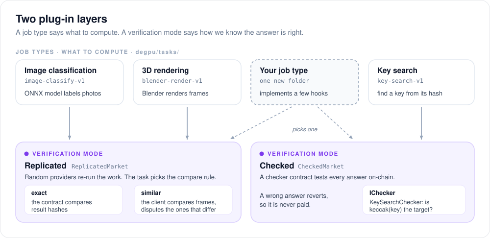
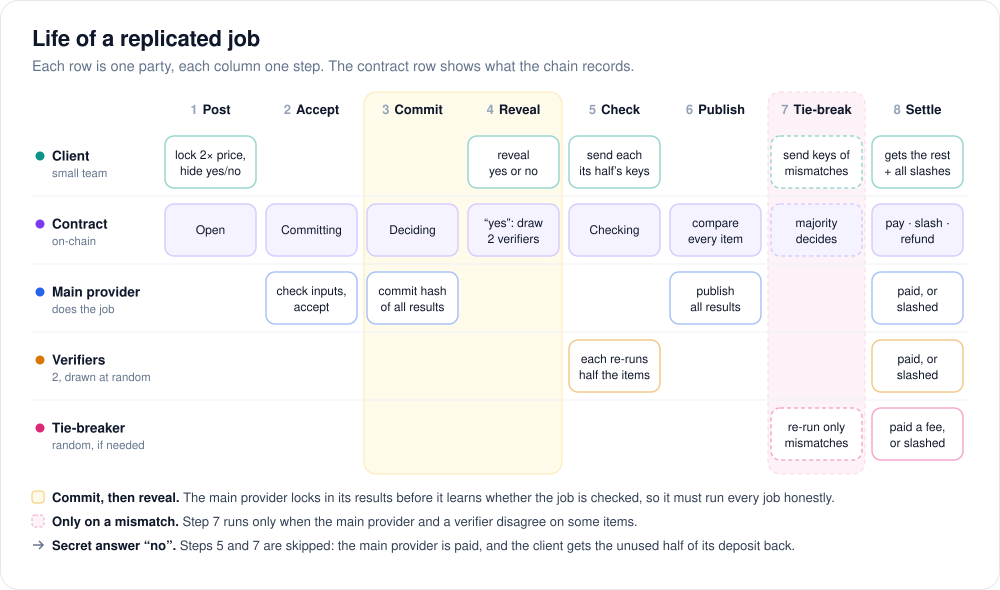
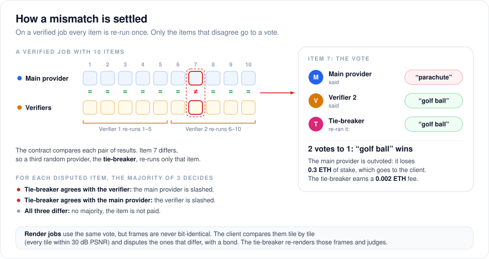
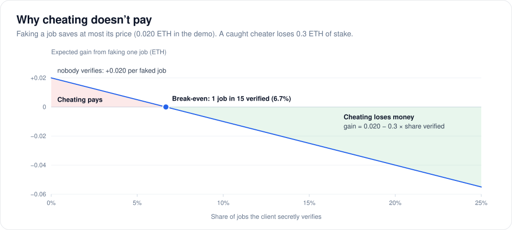
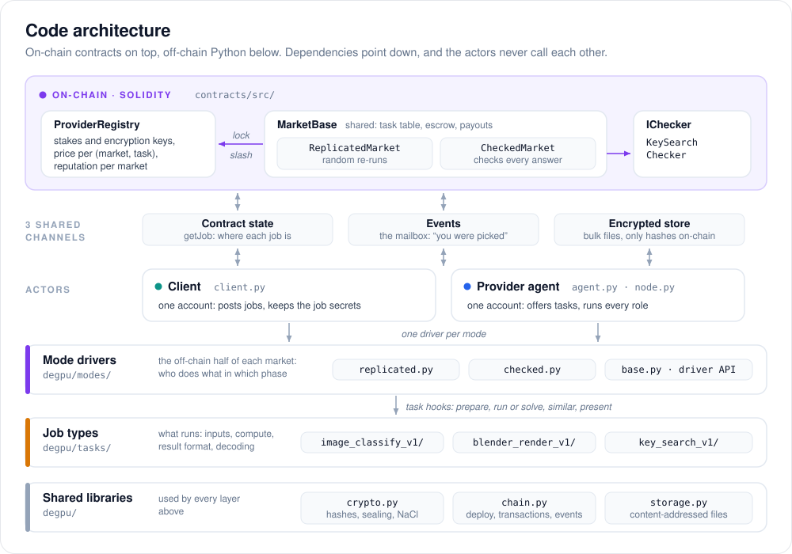
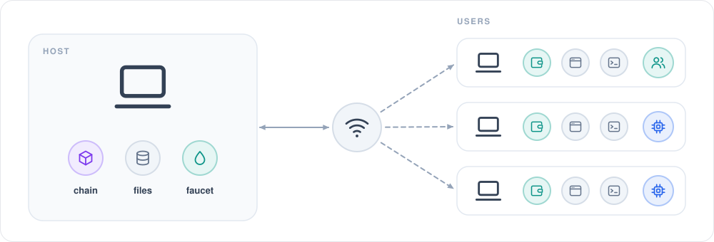

# DeGPU: an introduction

DeGPU is a small decentralized marketplace for computing power, built as a university blockchain course project. This document gives a short tour: what DeGPU does, its main features, how it keeps providers honest, and how the system is built.

For setup and every detail, see the [README](../README.md). For the code, see [ARCHITECTURE.md](ARCHITECTURE.md).

## 1. What is DeGPU?

**The problem.** Small teams often need computing power for a short time: to label a batch of photos, render a few animation frames, or run a search. Big cloud providers are expensive and see all your data. Meanwhile many machines sit idle. Renting from a stranger has a catch, though: how do you know they really did the work, and didn't just send back made-up results?

**Our answer.** DeGPU is a market where:
- **providers** lock a stake (a deposit of ETH) and rent out their idle machines;
- **clients** post jobs and pay into a smart contract;
- **smart contracts** hold the money, pick providers at random to check the work, pay honest providers and **slash** (take part of the stake from) providers who cheat or disappear.

The computing itself runs off-chain, on the providers' machines. Only money, stakes, hashes and decisions go on-chain.

## 2. Main features

| Feature | What it means |
|---|---|
| **Three job types** | Image classification (an ONNX model labels photos), 3D rendering (Blender renders frames), and key search (find a key that matches a hash). |
| **Two ways to check work** | *Replicated:* random providers re-run the work and compare. *Checked:* a contract tests each answer directly. |
| **Hidden verify decision** | The client secretly decides whether a job will be checked. The provider can't tell, so it must do every job honestly. |
| **Stakes and slashing** | A wrong result costs 30% of the stake, and a missed deadline 10% (5% for a verifier or tie-breaker). Slashed ETH goes to the client. |
| **Private data** | Job files are encrypted. Each provider gets only the keys for the items it must process. |
| **Plug-in job types** | A new job type is one folder of Python code, and it picks one of the existing ways to check work. |
| **Reputation** | The registry counts each provider's finished, missed and outvoted jobs, per market. |
| **Real network mode** | Several laptops on one Wi-Fi: one hosts the chain, and every user has a wallet, an app, a GUI and a CLI. |

The two plug-in layers are the core of the design. A **job type** says *what* to compute. A **verification mode** says *how* the platform knows the answer is right. They are independent, so adding a job type doesn't touch the contracts that check work.

## 3. How a job works

Every job has a few roles:
- **Client:** posts the job and pays.
- **Main provider:** chosen by the client; does the work.
- **Verifiers (2):** drawn at random by the contract; each re-runs half of the work.
- **Tie-breaker:** drawn at random only when the main provider and a verifier disagree.

The figure below follows one replicated job, such as labelling 200 photos. Read each column from top to bottom, and the columns from left to right.

The key trick is in steps 3 and 4:
- When posting, the client locks **2 × the price** and a **hidden yes/no** (only its hash goes on-chain). Every job looks the same on-chain, checked or not.
- The main provider must **commit** to its results (send a hash of them) **before** the client reveals the decision.
- So when the provider works, it doesn't know whether this job will be checked. The only safe choice is to do every job honestly.

If the answer is "no", the main provider is paid and the client gets the unused half of its deposit back. If it is "yes", two verifiers re-run the items, so every item is checked once.

**Checked jobs** are much simpler. The client posts public puzzles (for example "find the key in this range whose hash is X"), and the provider submits its answers. A checker contract tests every answer: a wrong one makes the whole call fail, so it can never be paid. The provider is paid per solved puzzle. If it misses the deadline, anyone can call `expire()` and the provider is slashed.

## 4. Keeping providers honest

### The tie-breaker vote

On a verified job, the contract compares the main provider's results with the verifiers' results, item by item. Most items match. For the items that don't, a third random provider, the **tie-breaker**, re-runs just those items, and the majority of three decides.

The outvoted party is slashed, so lying as a verifier doesn't work either: in the demo, when both verifiers lie, both lose 0.3 ETH and the honest main provider is still paid. Nobody can copy someone else's answer, because everyone commits a hash first and reveals later.

### Render jobs: similar, not equal

Two machines never render exactly the same pixels, so render results can't be compared by hash. Instead:
1. The client's app compares the main provider's frames with the verifiers' frames, tile by tile, using a fixed rule pinned with the job type (every tile must stay within 30 dB PSNR).
2. It disputes only the frames that differ, and pays a small bond to do so.
3. A tie-breaker re-renders those frames and judges who was wrong. If nothing was wrong, the bond pays the tie-breaker, so clients don't dispute for free.

### Why cheating doesn't pay

A provider that fakes a job saves at most the job's price (0.020 ETH for 200 photos in the demo). If it is caught, it loses 0.3 ETH of its stake. So once the client verifies more than about **1 job in 15**, cheating loses money on average, and the client still decides in secret which jobs those are.

| Cheat | What stops it |
|---|---|
| Lazy main provider makes results up | Commit before the hidden decision is revealed; on a verified job every item is re-run; slashed 30% |
| A verifier lies | The tie-breaker vote outvotes it; slashed 30% |
| A provider copies another's answer | Everyone commits a hash first and reveals after |
| A provider goes offline | Deadlines on every step; `expire()` slashes it 10% (5% for a verifier or tie-breaker) |
| Wrong answer to a checked puzzle | The checker contract rejects it on-chain |

## 5. Technical architecture

### On-chain and off-chain

The system has five layers:
- **Smart contracts** (Solidity) hold the money, the stakes and every judgement.
  - `ProviderRegistry` stores stakes, encryption keys, prices and reputation.
  - `MarketBase` holds what both markets share. `ReplicatedMarket` and `CheckedMarket` each implement one verification mode.
  - A checked job type adds a small checker contract, such as `KeySearchChecker`.
- **Actors** (Python): the client and the provider agent. Each one wraps one account.
- **Mode drivers:** the off-chain half of each market. They decide what each role does in each step.
- **Job types:** what actually runs: preparing inputs, computing, and reading results.
- **Shared libraries:** hashing and encryption, talking to the chain, and the file store.

**The design rule: actors never talk to each other directly.** Everything goes through three shared channels:
1. **Contract state** is the single source of truth for where a job is. Every actor reads it to choose its next move.
2. **Contract events** are the mailbox. They tell a provider it was picked and carry the secrets sealed for it.
3. **The encrypted store** holds the bulk files. Only their hashes go on-chain.

Because of this rule, the same code runs in a single process (the automated demo) or as separate apps on separate laptops.

### Running on a real network

For a live demo with classmates, one laptop runs `degpu host`. It serves:
- a local Ethereum chain (anvil), reachable only through a gateway that accepts reads and signed transactions, with no time travel and no free ETH;
- the encrypted file store;
- a faucet that gives each new wallet 2 test ETH, once.

Every user runs `degpu app` with their own wallet. The app signs transactions on the user's laptop and runs the automatic steps of every job in the background. The user drives it from a browser GUI or from the command line.

### Tech stack

| Part | Tools |
|---|---|
| Contracts | Solidity 0.8.28, Foundry (`forge`, `anvil`) |
| Off-chain code | Python 3.12 with `uv`, web3.py, PyNaCl (encryption), FastAPI (the app's API) |
| Job types | ONNX Runtime with MobileNetV2, Blender Cycles, keccak puzzles |
| GUI | React, Vite, TypeScript |

## 6. Privacy

For a replicated job:
- Every file is encrypted with a random key made for that job.
- The main provider gets the job key, so it sees every item.
- Each verifier gets only the keys for its half of the items, and the tie-breaker only the keys for the items in dispute.
- Keys are sealed to each provider's registered public key, so only that provider can open them.
- The chain stores only hashes, salted result hashes and sealed blobs, never the data itself.

Checked-mode puzzles are public by design: anyone can see the puzzle and the answer.

## 7. Results

Everything runs end to end on a local chain, and the tests pass:

| Check | Result |
|---|---|
| Solidity tests (`forge test`) | 98 passed in 10 suites |
| Python tests (`pytest`) | 118 passed; 3 skipped because they need Blender |
| Automated demo (`scripts/demo.py`) | passes; it checks every balance change in each scenario |

The demo runs these scenarios on a fresh chain (amounts in ETH):

| # | Scenario | Outcome |
|---|---|---|
| 1 | Image job, secret "no" | client −0.020, main provider +0.020 |
| 2 | Image job, secret "yes", everyone honest | client −0.040, main +0.020, each verifier +0.010 |
| 3 | Main provider fakes 20% of the labels | all 40 fakes caught; main slashed 0.3, client +0.278 |
| 4 | Both verifiers lie | both slashed 0.3; the honest main is still paid |
| 5 | Main provider goes offline | after the deadline, slashed 0.1; client +0.100 |
| 6 | Key search with one unsolvable puzzle | 19 keys found and paid; the unsolvable one is refunded |
| 7 | Key search with made-up keys | the checker rejects them on-chain; the provider is slashed 0.1 |
| 8 | Render job, everyone honest | the client accepts without a dispute |
| 9 | Render job, main degrades 3 of 12 frames | the client disputes exactly those 3; the main is slashed 0.3 |

Scenarios 8 and 9 need Blender, which isn't installed on our test machine yet. Their rows show the expected outcome; the similarity path itself is covered by tests with a stand-in render task.

## 8. Limitations and future work

This is a course project, so we block the obvious cheats and write the harder cases down instead of fixing them all:
- **The main provider sees the data.** Hiding data even from the provider would need secure hardware (a TEE).
- **Checking costs more.** A verified job costs twice the price, because every item runs twice. The hidden decision lets clients verify only some jobs and still keep everyone honest.
- **Randomness and collusion.** Providers are drawn using block data, which a block producer could influence. Chainlink VRF would fix this. Providers who work together can still swing an item.
- **A lazy tie-breaker** could copy one side instead of re-running the work.
- **The render threshold** (30 dB) is a placeholder until it is measured with real Blender renders.
- **The network host is trusted** to run the chain. A public testnet such as Sepolia removes that and needs only new network settings.
- **Scale.** Every result hash goes on-chain, which is fine up to 1,000 items. A Merkle root with per-item proofs would scale further.

Next steps we would like to explore: a third mode for services that can't be re-run (such as sharing bandwidth), random numbers from Chainlink VRF, Merkle proofs for large jobs, and deploying to a public testnet.
